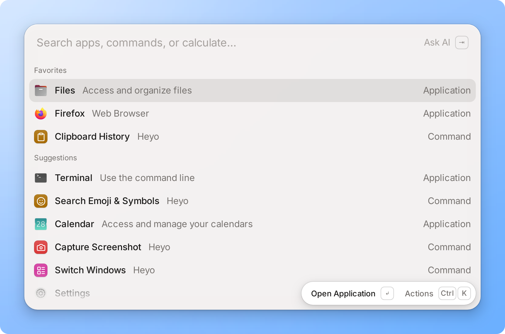
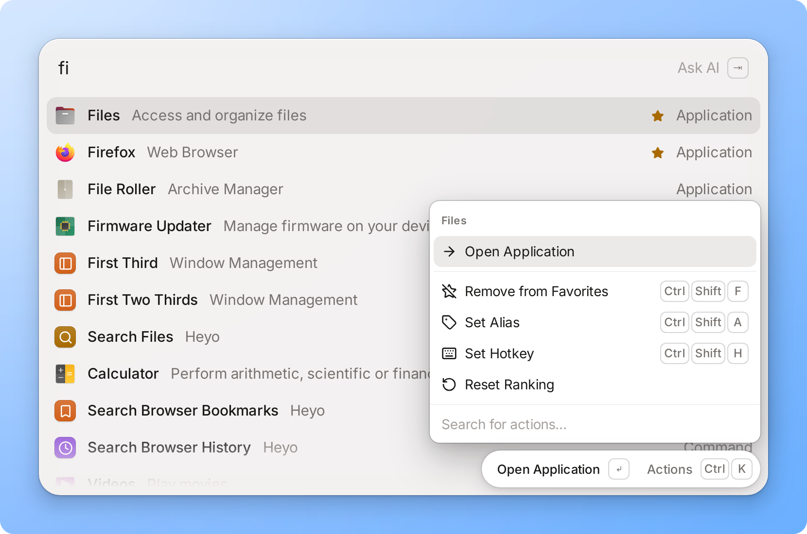
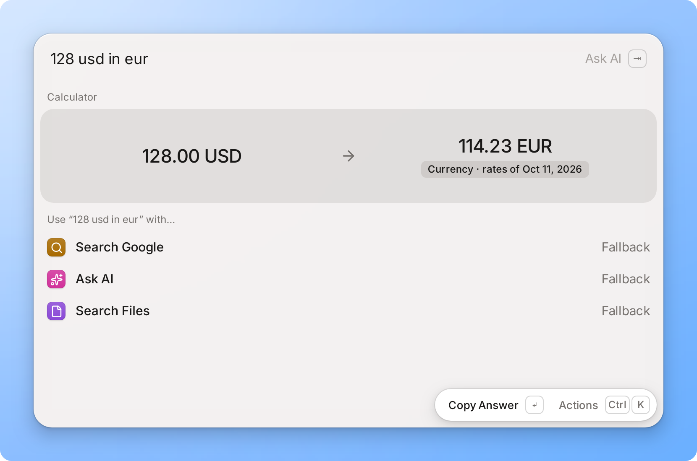
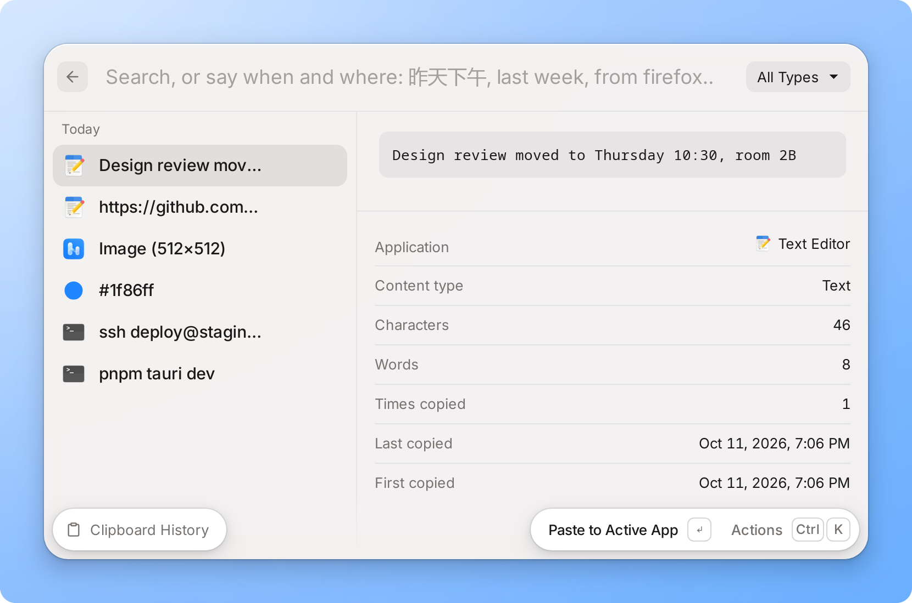
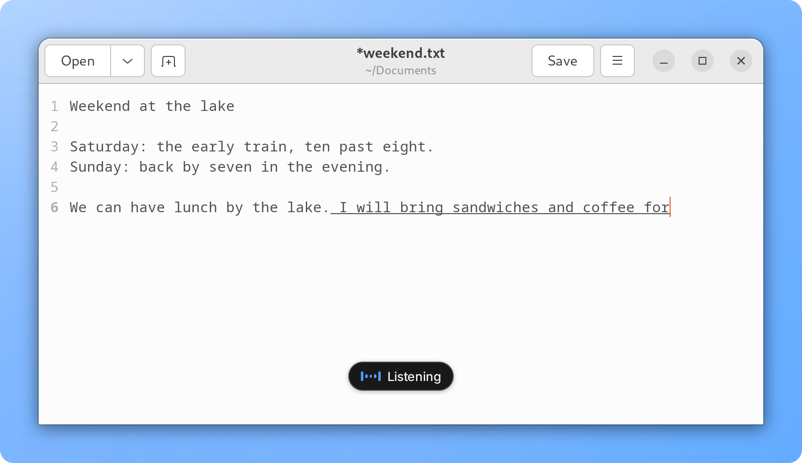
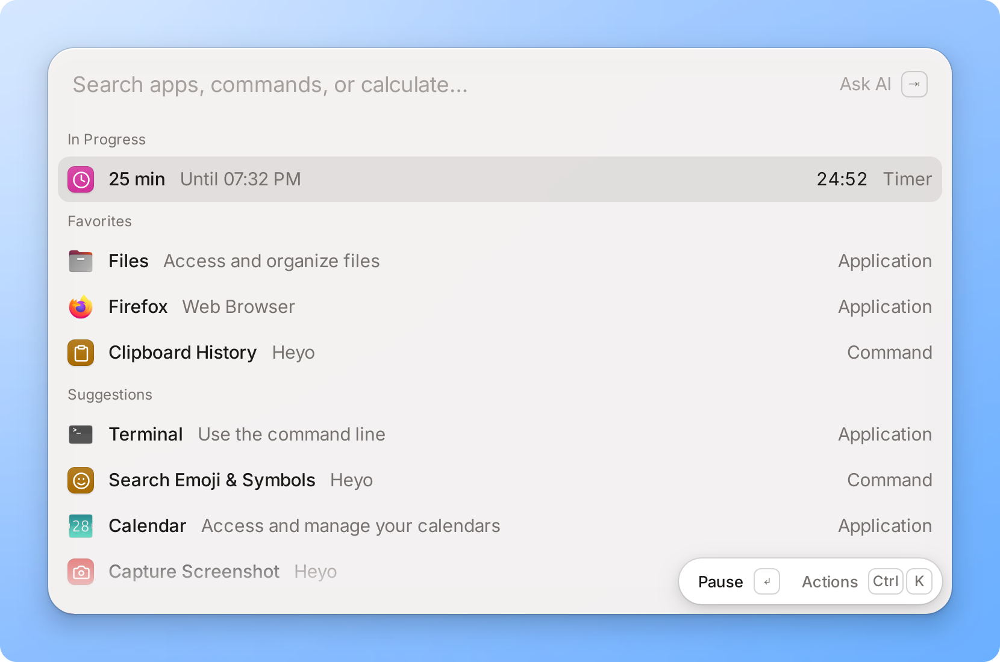
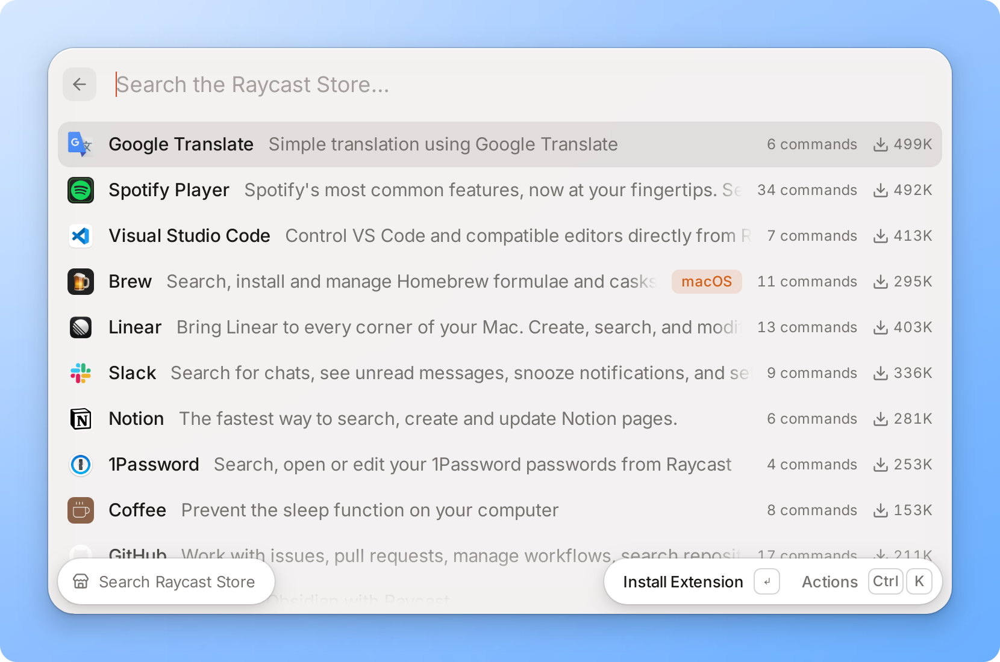
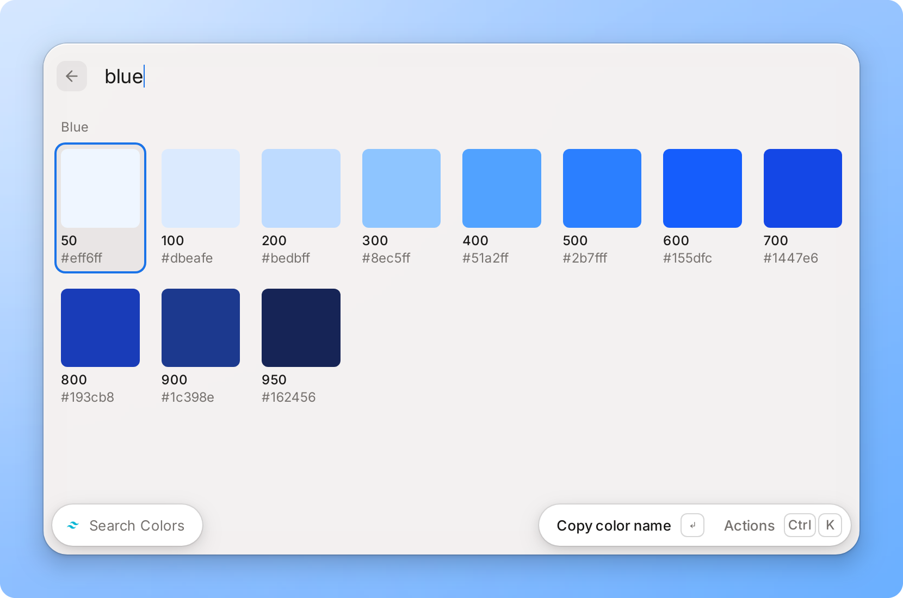
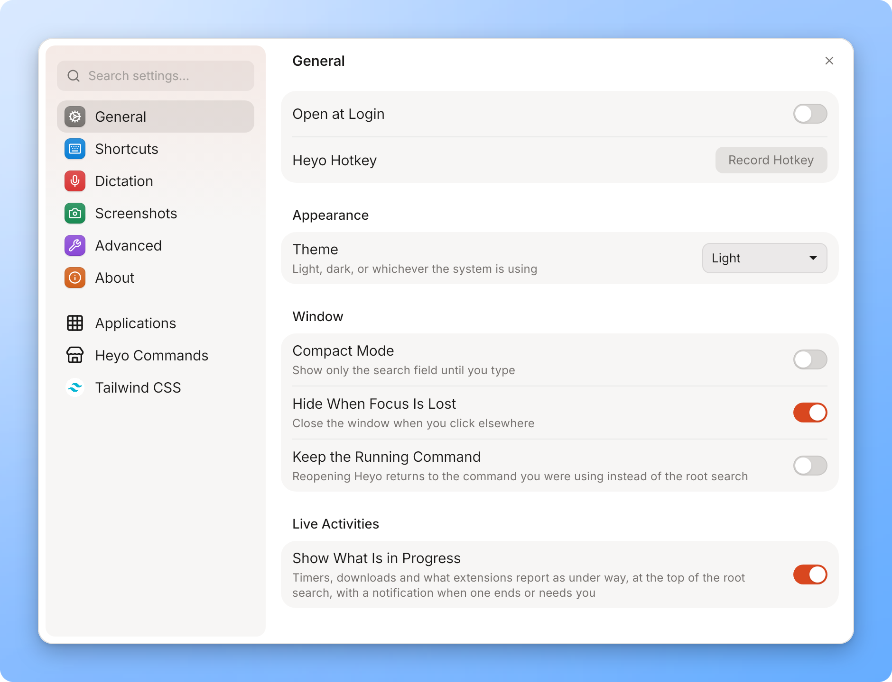

<p align="center">
  
</p>
<h1 align="center">Heyo</h1>
<p align="center">A command palette for Linux that runs Raycast extensions.</p>
<p align="center">
  <a href="https://github.com/hdonix/heyo/actions/workflows/ci.yml"></a>
</p>

<p align="center">
  <picture>
    <source media="(prefers-color-scheme: dark)" srcset="docs/images/palette-dark.png">
    
  </picture>
</p>

Heyo is a launcher you drive from the keyboard: press a hotkey, type a few
letters, press `Enter`. It opens applications, calculates, keeps a
clipboard history, arranges windows, takes screenshots and dictation, and
runs extensions written for [Raycast](https://www.raycast.com): the same
builds the Raycast Store hands out, installed from inside Heyo.

It is early: the first release, [0.0.1](https://github.com/hdonix/heyo/releases),
is a pre-release. Heyo is developed and used every day on Ubuntu 24.04
(GNOME on X11); [where else it runs](#where-it-runs), and how far along,
is below. Heyo is not affiliated with Raycast.

<p align="center">
  <a href="https://youtu.be/Hu0lVY2hJjg"></a>
  <br>
  <sub>A minute and a quarter of Heyo at work: <a href="https://youtu.be/Hu0lVY2hJjg">watch it on YouTube</a></sub>
</p>

## What it does

### Search, and act on what you find

<p align="center">
  <picture>
    <source media="(prefers-color-scheme: dark)" srcset="docs/images/search-dark.png">
    
  </picture>
</p>

One search over applications, commands, quicklinks and snippets. It
learns from use: what you open often comes first, and the empty search
shows your favorites and suggestions. `Ctrl+K` opens what can be done
with the selected row; any row can have an alias and a hotkey of its own.
What the search does not find can be handed on to the web, to files or to
your own quicklinks.

### Calculate and convert

<p align="center">
  <picture>
    <source media="(prefers-color-scheme: dark)" srcset="docs/images/calculator-dark.png">
    
  </picture>
</p>

Arithmetic, units, currencies and time zones, answered as you type:
`15% of 80`, `5 km in mi`, `100 usd in cny`, `3pm pst in beijing`. `Enter`
copies the answer.

### Clipboard History

<p align="center">
  <picture>
    <source media="(prefers-color-scheme: dark)" srcset="docs/images/clipboard-history-dark.png">
    
  </picture>
</p>

Text, links, colors, file paths and images, with the application each was
copied in. Search it by words, by when (`yesterday`, `上周三`), by where
from (`from firefox`) or by kind (`images`). It is kept on your computer,
and what a password manager marks as secret is never recorded.

### Dictation

<p align="center">
  <picture>
    <source media="(prefers-color-scheme: dark)" srcset="docs/images/dictation-dark.png">
    
  </picture>
</p>

Hold a key and speak, or start and finish with a hotkey: the words appear
in the application you are working in while you are still speaking.
Speech is recognized on your computer (Mandarin, Cantonese, English,
Japanese, Korean), and the audio never leaves it. A small window shows
the microphone's level meanwhile.

Where the application takes an input method, Heyo is that input method
for as long as you speak: the sentence in progress is composed at the
cursor, underlined, as Chinese is while it is typed, and becomes the
application's text when it is finished. Nothing is pasted and nothing is
erased, so your clipboard is left alone, and your own input method
(Pinyin, say) is back when you finish.

When you finish, an AI model (Claude, or one on your own computer) can
clean up what you said or translate it into English; it is sent the text,
never the audio. Words from a vocabulary of your own (names, terms) are
written the way you list them. Composing takes an X11 session with IBus
running, which GNOME starts by itself; elsewhere the words are pasted (on
GNOME on Wayland a sentence at a time), and on Windows dictation does not
work yet. [docs/usage.md](docs/usage.md#dictation) has the rest.

### What is in progress

<p align="center">
  <picture>
    <source media="(prefers-color-scheme: dark)" srcset="docs/images/live-activity-dark.png">
    
  </picture>
</p>

A timer, or something an extension reports as under way, stays at the top
of the palette while its command is away, with its own actions, and tells
you when it ends.

### And the rest

- **Windows**: switch between open windows; halves, quarters, thirds,
  maximize, center and next display for the focused one.
- **Screenshots**: select an area or a window, annotate, blur, then copy,
  save or pin it on screen; or copy the text in it, recognized on your
  computer.
- **Quicklinks and snippets**, with placeholders; snippets can expand as
  you type their keyword.
- **AI**, if you set it up: ask a question from the search with `Tab`,
  act on the text selected in any application. With Claude, or a model on
  your own computer.
- **Emoji and symbols**, file search, bookmarks and history of your
  browsers, audio devices, processes, lock, sleep and the other system
  commands.

[docs/usage.md](docs/usage.md) describes each, with its keys.

## Raycast extensions

<p align="center">
  <picture>
    <source media="(prefers-color-scheme: dark)" srcset="docs/images/store-dark.png">
    
  </picture>
</p>

**Search Raycast Store** browses the store, and `Enter` installs an
extension; its commands then appear in the search like Heyo's own. They
run unchanged, in Node.js, and Heyo draws their lists, grids, details and
forms itself.

<p align="center">
  <picture>
    <source media="(prefers-color-scheme: dark)" srcset="docs/images/extension-dark.png">
    
  </picture>
</p>

Not all of them work. Many extensions are written for macOS alone
(AppleScript, macOS programs), and those parts cannot run here. Of the 100
most-downloaded extensions, launched command by command on Linux, 15
launch cleanly, 19 stop at something only their user can give (an API
key, a sign-in), 49 launch but contain parts that cannot work here, 8 are
inconclusive and 9 fail. [docs/compatibility.md](docs/compatibility.md)
has the method and the full results.

To write an extension, or bring one over: `heyo dev`, `heyo build`,
`heyo ext check` and `heyo migrate` do without Raycast's own tool
([docs/developing-extensions.md](docs/developing-extensions.md)), and
[`@heyo/api`](packages/api/README.md) is `@raycast/api` with more on top:
windows, the screen, dictation, the clipboard history, live activities.

## Where it runs

| Platform | State |
|---|---|
| **Linux, GNOME on X11** | Where Heyo is developed and used every day (Ubuntu 24.04, arm64; CI builds and tests on x86_64). Everything on this page works here. |
| **Linux, GNOME on Wayland** | Through a small Shell extension that Heyo carries and offers to install (GNOME 45 to 50). Windows, pasting, the clipboard history and screenshots then work as on X11; snippets do not expand as you type. Tested in a container running GNOME 50, not yet on a real session. |
| **Linux, other X11 desktops** | The X11 code is not GNOME's alone, but hotkeys are only set up for you on GNOME (elsewhere, bind a shortcut to `heyo`), and no other desktop has had daily use. |
| **KDE, Sway, Hyprland and other Wayland desktops** | Not supported. Heyo has no adapter for them, which leaves launching, extensions and what generic tools can do; [docs/wayland.md](docs/wayland.md) says what each would take. Where the compositor offers the layer shell, the dictation pill, pinned captures and the screenshot overlay are placed by it; that much has been tried, under Sway only, in a container. |
| **Windows** | Behind. It compiles in CI, and a build ran in a Windows 11 virtual machine: the palette on `Alt+Space`, the Start menu's applications, a window layout, pasting, the clipboard history. Screen capture, the selected text, the hold-to-talk key, application icons and the installer are written and have only been compiled. Dictation does not work there yet. |
| **macOS** | No. |

## Install

Packages for Linux and Windows, on x86_64 and arm64, are on the
[releases page](https://github.com/hdonix/heyo/releases), and
[CHANGELOG.md](CHANGELOG.md) says what is in each version. Or build from
source; [packaging/README.md](packaging/README.md) describes how the
packages are made.

From source, for the current user, under `~/.local` (what the build needs
is in [docs/development.md](docs/development.md#what-you-need)):

```sh
git clone https://github.com/hdonix/heyo.git && cd heyo
pnpm install
scripts/install.sh --build       # scripts/install.sh --uninstall removes it
```

A package installs as packages do:

- Debian, Ubuntu: `sudo apt install ./Heyo_<version>_<arch>.deb`
- Fedora, openSUSE: `sudo dnf install ./Heyo-<version>-1.<arch>.rpm`

Heyo needs WebKitGTK 4.1. Extensions, dictation and text recognition also
need Node.js 22 or newer (`node` on `PATH`, or its path in Settings →
Advanced); the launcher itself works without. The packages only recommend
Node.js, because most distributions ship an older one: install a current
one from nodejs.org or with a version manager. On X11, pasting into other
applications uses `xdotool`.

## The first minute

1. Start **Heyo** from the applications menu, or run `heyo`. The palette
   opens.
2. Give it a hotkey. On GNOME: `Ctrl+,` opens the settings, and General →
   Heyo Hotkey records one. On another desktop, bind a shortcut of the
   desktop's own to the command `heyo`: running it again shows and hides
   the palette.
3. Type a few letters of an application or a command, `↑`/`↓` to choose,
   `Enter` to open. `Esc` clears what you typed, then hides the palette.
4. `Ctrl+K` shows everything that can be done with the selected row: add
   it to the favorites, give it an alias or a hotkey.
5. Open **Search Raycast Store** and install an extension.

<p align="center">
  <picture>
    <source media="(prefers-color-scheme: dark)" srcset="docs/images/settings-dark.png">
    
  </picture>
</p>

The interface is light or dark, following the system unless you choose.

## Documentation

| Document | What is in it |
|---|---|
| [docs/usage.md](docs/usage.md) | every feature, its keys, and where Heyo keeps things |
| [docs/compatibility.md](docs/compatibility.md) | which Raycast extensions run, measured |
| [docs/developing-extensions.md](docs/developing-extensions.md) | writing extensions with `heyo dev`, `build`, `ext check`, `migrate` |
| [docs/extension-api.md](docs/extension-api.md) | the specification of `@heyo/api`; [packages/api/README.md](packages/api/README.md) is the short introduction |
| [docs/architecture.md](docs/architecture.md) | how Heyo is built: the host, the web view, the runtime, and how they talk |
| [docs/development.md](docs/development.md) | building, running, testing and debugging Heyo |
| [packaging/README.md](packaging/README.md) | how the packages are built, and what a release still needs |
| [CONTRIBUTING.md](CONTRIBUTING.md) | how to contribute, and how commits are written |

[docs/README.md](docs/README.md) lists everything.

## Licence

[GPL-3.0](LICENSE). Heyo is an independent project and is not affiliated
with or endorsed by Raycast.
