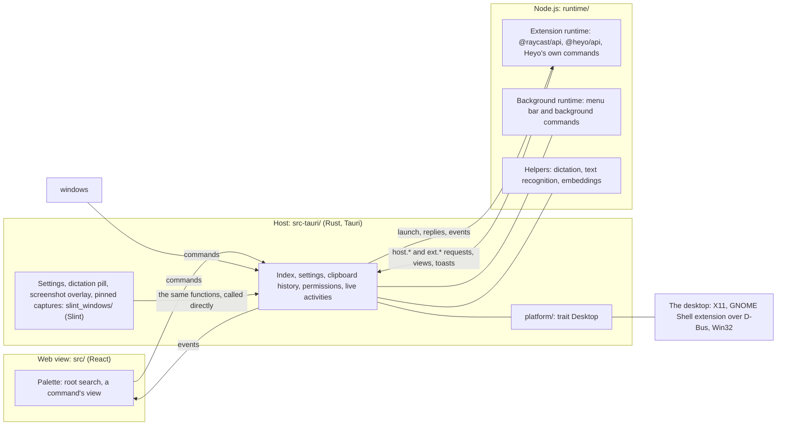
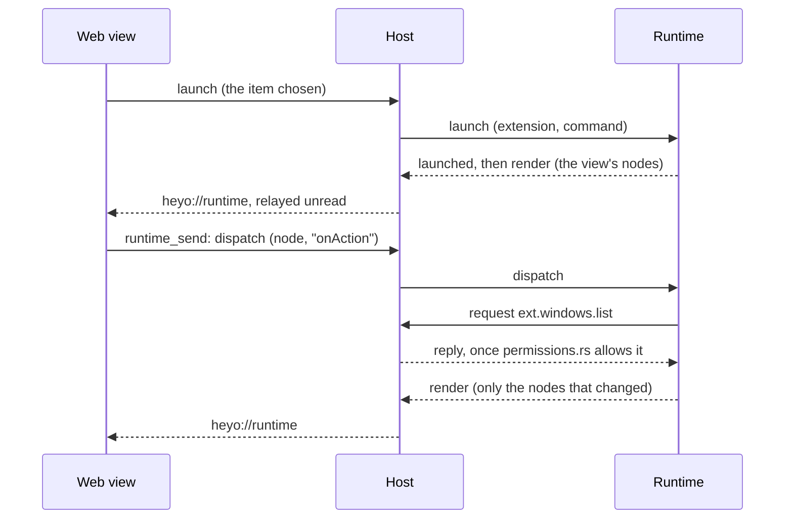

# How Heyo is built

For someone about to read or change the code. What Heyo does is in the
[README](../README.md); how to build, run and test it is in
[development.md](development.md).

## The three parts

Heyo is three programs that talk to each other, and a layer that talks to
the desktop.



- **The host** (`src-tauri/`, Rust, [Tauri](https://tauri.app) 2) is the
  process the user starts. It owns the windows, the index of what can be
  opened, the settings, the clipboard history, the permissions extensions
  have been given and everything that touches the desktop. It starts the
  other two parts and carries their messages.
- **The web view** (`src/`, React 19, in WebKitGTK on Linux and WebView2 on
  Windows) draws the palette (`main`). It keeps nothing of its own: what
  it shows it asked the host for, or was sent by the runtime. The settings
  window, the dictation pill, the screenshot overlay and a pinned capture
  it does not draw: those are the host's own, drawn with
  [Slint](https://slint.dev)
  ("[The windows Slint draws](#the-windows-slint-draws)" below).
- **The runtime** (`runtime/`, Node.js 22 or newer) runs extensions: the
  builds the Raycast Store hands out, loaded as they are. It gives them
  `@raycast/api`, `@heyo/api` and React, renders their components with a
  React reconciler into a tree of plain objects, and sends that tree to the
  web view to be drawn. Heyo's own view commands (the Store, Clipboard
  History, emoji, quicklinks and snippets, the AI commands, the Timer) are
  written the same way and live in `runtime/src/builtins/`.

The runtime is started when a command first needs it, and there may be two
of it: the one whose command is in the palette, and a second for menu bar
and background commands (`runtime/src/background.ts`), so that those never
disturb the command on screen. Dictation, text recognition and the
embedding model are further Node.js programs of their own (their engines
are native packages installed on demand), started the same way
(`src-tauri/src/helper.rs`). The launcher itself works without Node.js.

## How the parts talk

### One declaration for every message

A message that crosses between two parts is declared once.

- What the host reads or writes is declared in Rust, in
  `src-tauri/src/wire.rs`: what the runtime asks of the host for itself
  (`HostRequest`), what an extension asks through `@heyo/api`
  (`ExtRequest`), what the host tells the runtime (`HostMessage`), what the
  web view may tell the runtime (`WebviewMessage`), and the names of the
  events the host emits to its windows. `cargo test` writes the TypeScript
  of all of it into `shared/bindings/` (with
  [ts-rs](https://github.com/Aleph-Alpha/ts-rs)); the files are committed,
  and CI fails when they are not what the host declares.
- What the host only passes along, between the runtime and the web view,
  is declared in `shared/wire.ts`, where both ends can see it: the view
  tree (`WireView`, `WireNode`), toasts, `RuntimeMessage`, and what the
  host answers each `ext.*` request with (`ExtReplies`).

### Web view and host: commands and events

What a window asks of the host is a command: a `#[tauri::command]`
function, registered in `lib.rs`. Each is said twice more, and `cargo test`
fails until both are there:

- which windows may call it (`commands/access.rs`). Every window loads the
  same page and the palette draws what extensions hand it, so a window is
  held to the commands its own view calls. What changes the settings is no
  command at all: the settings window is not a web view, and calls those
  functions directly;
- what it takes and answers as a window sees it (`commands/bindings.rs`,
  which also says what every event carries). That table is written to
  `shared/bindings/commands.ts`.

The web view calls through that table: `call("copy_text", { text, paste })`
and `listen("settingsChanged", …)` from `src/host.ts` do not compile with
a name, an argument or a payload the host does not have
(`src/host.check.ts` holds that to its word). A call that fails is handled
where it matters and otherwise ends in `.catch(reported(…))`, which shows
it in the window's toast or error line. Tests of the web view play the
host with `fakeHost` (`src/host.fake.ts`), typed by the same table.

### Host and runtime: JSON lines

The runtime's process talks to the host in JSON, one message a line, over
its stdin and stdout. What it writes to stderr joins Heyo's log.
`src-tauri/src/runtime.rs` sorts what arrives (`route`):

| The runtime sends | Who answers |
|---|---|
| a request whose method begins `host.` (the clipboard, opening things, hiding the palette, the index, the keeping of the clipboard history) | the host, in `host.rs` |
| a request whose method begins `ext.` (windows, the screen, dictation, the file index, live activities, …: everything behind `@heyo/api`) | the host, in `ext.rs` and `ext/answer.rs`, after asking `permissions.rs` |
| anything else from the palette's runtime (`launched`, `render`, `toast`, a `ui.confirm` request, …) | the web view: the host relays it unread as the `heyo://runtime` event |
| anything else from the background runtime (`menu`, `background-done`) | `menubar.rs` |

In the other direction the host sends `launch` (start this command),
`background-run`, the replies to requests, `progress` (how far a request
answered over time has got), `event` (something a command subscribed to
has happened), `oauth-callback`, `appearance` and
`dev-reload`; and it passes on what the web view says through the
`runtime_send` command: `dispatch` (call the function at this node and
prop, such as an `onAction`), `pop`, `close`, `reply`.

On the runtime's side, `transport.ts` is what carries the conversation
(the process's pipes, or a pair in memory with a test in the host's place)
and `protocol.ts` is the conversation itself: `request()` for `host.*` and
`ui.*`, `ask()` for `ext.*` (which says which extension is asking), and
`on()` for what the host sends.

A subscription is a request the host answers with a number; events with
that number follow until the command ends it, the command itself ends, or
the runtime's process is gone (`ext.rs`, `runtime/src/heyo/events.ts`).

A question to a model (`host.ai.ask`) is a request answered over time:
the host tells the answer as it is written (`progress`, with the
request's number) before it replies with all of it, and `host.cancel`
calls it off (`src-tauri/src/ai.rs`, `requestOverTime` in `protocol.ts`).
The runtime sends the question alone: it has neither the key nor the
address of any model.

### A command, from Enter to the screen



Function props cannot cross a process boundary: the runtime sends
`{ $fn: 1 }` in their place, and the web view calls them back by node id
and prop path (`runtime/src/renderer.ts`). After the first, a `render`
carries only the nodes that changed (`runtime/src/session.ts`). What is
typed into a field the extension controls belongs to the field at once and
the extension is told after, so that a slow extension cannot lose
keystrokes or break an input method's composition (`src/raycast/typing.ts`).

## The source tree

```
src-tauri/          the host (Rust)
  src/              see "The host" below
  icons/            the application's icons, made by scripts/app-icon.py
                    from the picture in source/
  tauri.conf.json   windows, what the web view may load, what a package holds
src/                the web view (React, TypeScript)
  raycast/          draws what extensions render: List, Grid, Detail, Form,
                    the action panel
  styles/           SCSS: scales, mixins, tokens, a partial per component
runtime/            what runs in Node.js (TypeScript), bundled by build.mjs
  src/              into runtime/dist/heyo-*.cjs
    api/            the @raycast/api implementation
    heyo/           the @heyo/api implementation
    builtins/       Heyo's own commands
    dev/            heyo build, dev, migrate, ext check
shared/             what more than one part reads
  bindings/         generated from the host's types by cargo test
  wire.ts           messages the host only passes along
  placeholders.ts   {query}, {clipboard}, {date}… for quicklinks and snippets
packages/api/       @heyo/api as extension authors install it: types, and a
                    stand-in for use outside Heyo
gnome-extension/    the GNOME Shell extension Heyo carries, for Wayland
packaging/          how packages are built (packaging/README.md)
scripts/            install.sh, the GUI sandbox, the Wayland container, the
                    Windows machine, the compatibility run, the icon and
                    shadow generators
docs/               the documents (docs/README.md lists them)
```

## The host

`lib.rs` is the start: it builds the Tauri application, registers the
commands, holds the shared state (the index, the settings, the runtimes)
and keeps the list of applications current. The rest, by what it is for:

**Opening things.**

- `root.rs` is the root search: applications, commands, quicklinks and
  snippets, ranked by fuzzy match (`search.rs`, with nucleo), how often
  and how recently each was used (`usage.rs`), aliases and favourites.
- `open.rs` is the one way an item is opened, by its id
  (`app:<desktop id>`, `cmd:<extension>:<command>`,
  `heyo:<native command>`, `quicklink:<id>`, `snippet:<id>`), whether it
  was chosen in the palette, bound to a hotkey or asked for with
  `heyo --open`. `cli.rs`
  reads the command line, including what a second `heyo` hands to the
  running one.
- `apps.rs` and `apps/` find the installed applications: freedesktop
  `.desktop` entries, or the Start menu's shortcuts and Store applications
  on Windows. `extensions.rs` finds the installed extensions and their
  commands, and declares Heyo's own.
- `palette.rs` is the palette's window and all that is done with it. The
  rest of the host says what it means (the palette is opened, is done
  with, makes way for a capture, is needed for a question) and never has
  the window in hand.

**Running extensions.**

- `helper.rs` is the one place that finds the Node.js scripts, starts
  them, frames their messages and notices them ending. It refuses a script
  whose first line does not name this version of Heyo. `runtime.rs` is the
  extension runtime as a helper, and the relay described above.
- `host.rs` answers the runtime's own requests. `ext.rs` answers what
  commands ask through `@heyo/api`, each on a thread of its own, since an
  answer may wait on a question to the user.
- `ext/answer.rs` decides what an `ext.*` request is answered with: who
  asks, whether they may, whether this session can, and then the thing
  itself. Everything it consults or changes is handed in as a `World`
  (Heyo's tables, and a port, `Running`, for what only the running
  application can do), and what is left to do once the answer is known
  comes back as `Effect`s. So a test answers requests with tables of its
  own and a fake desktop, and needs no application.
- `permissions.rs` is what an extension may ask for and who said so: the
  permissions its manifest lists, the ones the user granted (kept in
  `permissions.json` until taken back in the settings), and the decision
  for one request. It is consent and a record, not a sandbox: extensions
  run in one Node.js process and can read files themselves. `confirm.rs`
  is how the host puts a question of its own into the palette's dialog.
- `models/` is every call to an AI model, and the only place one is made:
  `Model` with its two adapters, Claude over HTTPS (`claude.rs`) and an
  OpenAI-compatible server (`openai.rs`), picked from the settings, with
  each failure worded for the user once; `address.rs` says whether a
  model's address is this computer. `ai.rs` answers the runtime's
  questions with it.
- `menubar.rs` turns menu bar commands into tray icons and runs commands
  that have an `interval`. `links.rs` registers Heyo for the `raycast://`
  links that OAuth sign-ins come back through.

**Doing things for the user.**

- `pasting.rs`: every paste goes through here, whether it comes from
  dictation, a snippet, an extension or the palette. Heyo types nothing
  itself: it puts the text on the clipboard and presses the application's
  paste shortcut. Text the user did not copy goes onto a clipboard on loan
  (`Loan`) and what was there comes back afterwards; several lines bound
  for a terminal are asked about first, or go in on one line. Text that
  takes the place of what stands before the cursor (a snippet's keyword,
  dictated words being corrected) is on loan too: Backspaces and a paste,
  pressed by `platform::typed`.
- `clipboard.rs` and `clipboard/` are the clipboard history: what is
  recorded and what is not (`sources.rs`), where it is kept (one SQLite
  file with two full-text indexes, `store.rs`), how a query is read
  (`query.rs`: when, from where, what kind), and the optional search by
  meaning with a model on the computer (`meaning.rs`, `vectors.rs`,
  `fusion.rs`). `eval.rs` measures the search.
- `activities.rs` is the live activities (things in progress, shown in the
  palette's "In Progress" section and as notifications). The table
  (`Table`) is plain data with the time passed in; what a change calls for
  outside it comes back as `Effect`s, which a thin shell at the bottom of
  the file carries out. The limits, the ordering and the timers are all
  tested without a window.
- `screenshot.rs`, `ocr.rs` and `dictation.rs` are those features: the
  capture and what becomes of the part selected (`screenshot/selecting.rs`
  is the overlay's rules, which know no toolkit), the text-recognition
  helper, the dictation helper with its progress window.
- A recording's words reach the application one of two ways, which
  `dictation.rs` chooses when the recording starts (`Way`, with a thread
  of the recording's own to go it). Each has a module that is told what
  was heard and answers with what to do, and touches nothing, so that it
  is tested with a text field made of a string:
  - `dictation/composed.rs`, where the window in front takes the
    session's input method: the sentence in progress is shown there as
    text being composed ("type as you speak"), a finished one is
    committed, and with polishing the whole recording is composed until
    the polished text is committed in its place. It also says what
    becomes of the text being composed when the user presses a key,
    clicks, or goes to another window. `platform::composing` is what it
    is said to.
  - `dictation/onscreen.rs`, everywhere else: the words pasted as they
    are spoken and corrected where they stand, or each sentence when it
    is finished, or the polished text at the end. It answers with steps
    (erase so many characters and write this; paste that), and it is
    where the rule lives that Heyo erases only what it wrote itself: its
    module header has the cases. A recording that can no longer be
    composed goes on here, from what the application holds by then.
- `expand.rs` expands a snippet's keyword as it is typed in another
  application. The keyboard is only listened to, never grabbed, and what
  is typed is neither stored nor logged; the module header says exactly
  when a keyword counts as typed.
- `library.rs` reads quicklinks and snippets; `files.rs` is the in-memory
  file search.

**Keeping the house.**

- `settings.rs`: see "Settings" below. `paths.rs` names every place Heyo
  keeps things, once (the XDG base directories; on Windows `lib.rs` points
  those at `%APPDATA%` and `%LOCALAPPDATA%` first).
- `diagnostics.rs` keeps the log, writes panics into it and assembles what
  "Copy Diagnostics" copies, with secrets and the home directory scrubbed.
- `renderer.rs` chooses how WebKitGTK draws (on the GPU, or on the CPU
  where NVIDIA's driver leaves no other way) before the web view exists.
- `updates.rs` is the updater, which is not compiled unless a build asks
  for it ([packaging/README.md](../packaging/README.md)).

## The platform layer

`src-tauri/src/platform/` is where Heyo meets the desktop it runs on.
Anything that touches the desktop goes through it.

Its modules of plain functions are what the rest of Heyo uses: `windows`
(listing, switching, layouts), `input` (the paste keystroke, the selected
text), `clipboard_watch`, `capture`, `keys` (hold to talk),
`typed` (what is typed elsewhere, and replacing it there: for snippets,
and for dictated words that are corrected as they come), `composing` (text
composed in another application as an input method does: for dictated
words), `hotkeys`, `focus`, `system` (locking, the volume, the trash, audio
devices, processes) and `common` (notifications, keeping awake). They hold
what is the same everywhere and ask the session's adapter for the rest.

The seam is one trait, `desktop::Desktop`: everything Heyo asks of a
desktop. Each session has one adapter, chosen once:

| Adapter | Session | Through |
|---|---|---|
| `x11::X11` | X11 | EWMH for windows, XFixes for the clipboard, XInput for the keys it listens to, direct screen reads, `xdotool` for the paste keystroke, XTEST for replacing text, IBus for composing it |
| `gnome::Gnome` | GNOME on Wayland, when Heyo's Shell extension answers | D-Bus calls to the extension |
| `win::Windows` | Windows | the Win32 API |
| `desktop::Generic` | anything else | generic tools, where there are any: `wtype` or `ydotool`, a polled clipboard, `gnome-screenshot` |

What an adapter does not implement stays at the trait's default, which
says "not supported": nothing falls through to another desktop's tools by
accident. `platform::capabilities()` reports what the session can do, so
commands that cannot work are left out of the search and the settings say
why. Supporting another desktop is one more adapter; a capability new to
all of them is one more method, and the compiler finds nothing else to
change. Tests put `desktop::fake::Fake` in the adapter's place.

### Replacing text in another application

Two features erase in someone else's text field and write something in
its place: a snippet's keyword becomes its text, and dictated words are
corrected while the sentence is still being spoken. Both go through
`platform::typed`, and only X11 has an adapter for it (`x11/typed.rs`,
`x11/writing.rs`, `x11/offer.rs`). What it holds to:

- The keyboard is listened to and never grabbed, and the keys of one
  replacement (Backspaces, then the paste shortcut) reach the X server
  pressed and released in a single write: whatever becomes of Heyo, no key
  stays down and nothing stays held.
- The text is on the clipboard with Heyo itself as the clipboard's owner,
  so the application's asking for it is seen: a replacement is over when
  the application in front has taken the text, and one that was not seen
  to be taken is said to be lost. Nothing has to wait and hope.
- Writing piece after piece (`Writing`, for dictation) stops for good at
  the first sign that anything else touched the text: a key of the
  user's, a click, the focus leaving the window. It listens on the same
  connection it presses keys through, so the last look comes just ahead
  of the keys. `x11/writing.rs` says what counts and what does not.

Both have a test against a real X server (`cargo test -- --ignored
on_an_x_server`, on a server of one's own), with a small application in
it to write into (`x11/field.rs`).

### Composing text in another application

Dictated words are better composed than pasted: text being composed is
shown in the application without being its text yet, may be replaced as
often as it changes, and becomes the application's when it is committed.
Nothing is erased, the clipboard is not borrowed, and no key is pressed.
That is what an input method does, so for the length of a recording Heyo
is one (`platform::composing`, and `platform/ibus.rs` for IBus, which is
what GNOME runs):

- Heyo connects to IBus's own bus, registers a component with one engine
  over that connection (nothing is installed, and nothing is left when
  the connection ends), and answers the daemon's calls to the engine
  itself, one at a time in the order they arrive (`ibus/engine.rs`): a
  key the user presses is answered after what it made the engine say.
- A session has one engine at a time. Heyo notes the user's in a file,
  makes its own the session's, and gives the user's back when the
  recording is over. The order of giving back is forced by the daemon:
  when a component registered this way leaves, it takes the engine away
  from the field that has the focus, whichever engine that is. So Heyo
  leaves first and then sets the user's engine, over a second connection
  that offers nothing. A Heyo that is killed while it composes leaves the
  session without an engine, and the file: the next one to start reads it
  (`composing::recover`). GNOME Shell follows the engine without acting on
  it; if the user chooses another input source meanwhile, composing ends
  and that source stays.
- Text being composed is dropped, not kept, when its field lets go of it
  (it loses the focus, the user clicks in it): a field kept a
  half-recognized sentence otherwise every time a hotkey took the focus
  for a moment, with the finished sentence written after it. What the
  user's own key interrupts is committed ahead of the key instead.
- Composing is refused, and the words pasted, where the window in front
  has no field for an input method, the field is a password's, the
  session's framework is another (Fcitx), or IBus is older than 1.5.27
  and does not say whose field has the focus.

`cargo test -- --ignored with_an_ibus_daemon` starts an ibus-daemon of its
own, with directories of its own, and plays the application to it.

### GNOME on Wayland

On Wayland an application cannot see other windows, type into them, follow
the clipboard while unfocused, or read the screen; the Shell can. Heyo
carries a small Shell extension, `gnome-extension/heyo@heyo.app` (GNOME 45
to 50), that does those things for it over D-Bus and answers only the
process that owns Heyo's bus name. Settings → General offers to install
it, and to update it when a newer Heyo carries a newer one, after which
the user logs out and in again: GNOME only loads a new or updated
extension when a session starts, and an older one keeps serving until
then (`platform/gnome/extension.rs`).

With it, window switching and layouts, pasting, the selected text,
clipboard history and screenshots work as on X11, and the hold-to-talk
key works with the modifier keys. Snippets do not expand as they are
typed: that would put a listener for every key into the Shell, and has
deliberately not been done. For the same reason dictated words are not
pasted and corrected as they are spoken: without hearing the user's own
keys Heyo could not know that what it erases is its own, so each sentence
is pasted when it is finished. (Composing them through IBus, which the
Shell runs here too, needs none of that, and has not been tried on
Wayland yet.) Without the extension, or on another Wayland desktop, the
`Generic` adapter is what is left.

[wayland.md](wayland.md) has the details: what Heyo needs of a compositor,
how each version of GNOME differs, and what KDE and the wlroots
compositors could offer.

### Windows

`platform/win/` is the adapter for Windows, through the Win32 API: other
applications' windows, pasting, the selected text (UI Automation, else a
copy that is put back), the clipboard, the screen, a key held to talk, and
global hotkeys registered with the system and kept in `hotkeys.json`.
What it works out without asking Windows is in `win_rules.rs`, and what
the Start menu's files say is in `apps/shortcut.rs`: kept apart so that
they are compiled and tested wherever Heyo is built.

Part of this has run in a Windows machine and part has only been compiled;
the [README](../README.md#where-it-runs) says which, and
`scripts/windows-test/CHECKLIST.md` is the list of what is to be tried.

### Hotkeys

Hotkeys need nothing from a compositor but a way to run a command. Heyo is
single-instance: running `heyo` again hands its arguments to the one that
is running, so every hotkey is `heyo` (toggle the palette),
`heyo --clipboard` or `heyo --open <item id>`. On GNOME, Heyo writes them as
custom keyboard shortcuts with `gsettings` (`platform/hotkeys.rs`); on
Windows it registers them itself.

## The web view

- `App.tsx` hosts the root search or a running command.
- `RootSearch.tsx` is the root search as it is drawn, with the keys and
  clicks it takes. What a row is and does, it asks `rows.ts`: `rowsFor`
  puts the four kinds of row in order (what is in progress, the
  calculator's answer, what the search found, what else the query can be
  used with) and `describe` says what a row does, as groups of actions.
  Nothing in `rows.ts` draws or keeps anything, which is what makes it
  testable. `calculator.ts` is the arithmetic, the units, the currencies
  and the time zones.
- `raycast/` draws what extensions render. `CommandView.tsx` is a running
  command (search bar, body, footer, action panel); `ListView.tsx`,
  `Detail.tsx` and `FormView.tsx` are the bodies; `actions.tsx` is the
  action panel, the same one for an extension's actions and the root
  search's; `model.ts` reads the tree the runtime sends; `memory.ts`
  remembers what a view was showing when another was pushed over it.
- `selection.ts` and `pointer.ts` are what every list shares: how the
  selection moves, and when a mouse event is the pointer really moving.
  `SelectionIndicator.tsx` is the one element that slides between rows.
- `ime.ts`: while an input method is composing, Enter, Escape and Tab are
  its own. Every key handler that acts on those asks `composing(e)` first.

## The runtime

- `main.ts` is the process and its pipes; `runtime.ts` is the runtime as
  the host knows it: what extensions are handed when they load, and what
  each of the host's messages does. A test starts it with itself in the
  host's place (`testhost.ts`, `testing.ts`).
- `session.ts` runs one command at a time and sends its views;
  `renderer.ts` is the React reconciler behind that.
- `api/` is `@raycast/api`: the components (`components.ts`), navigation,
  the parts that are not interface (`system.ts`: clipboard, `open`,
  storage, …), OAuth, window management. What is there by name and does
  not do its work on Heyo is said once, in `shortfalls.ts`.
- `heyo/` is `@heyo/api`: everything of `@raycast/api` under the same
  names, and Heyo's own on top. Every function Heyo adds is declared once,
  in `members.ts`: the module it is in, its name and the request it asks
  of the host. A function that is nothing but its request is made from the
  declaration; the permission it needs and what it answers with follow
  from the request (`shared/bindings/needs.ts`, `ExtReplies`); and
  `types.check.ts` holds the types authors see (`packages/api/index.d.ts`)
  to what the runtime provides.
- `builtins/` is Heyo's own commands, written against `@heyo/api` as an
  extension would be.
- `dev/` is the developer tools, bundled separately as `heyo-dev.cjs` and
  started by `heyo build`, `dev`, `migrate` and `ext check`
  ([developing-extensions.md](developing-extensions.md)).
- `dictation.ts`, `ocr.ts` and `embed.ts` are the helpers, each a program
  of its own. `sentences.ts` is one recording as the dictation helper
  hears it (the sentence in progress, each finished sentence), apart from
  the program so that a test can play the recognizer. `install.ts`
  fetches the helpers' engines and models: exact revisions, checked
  against hashes written in the source.
- `compat.ts` helps extensions written with only macOS in mind, where
  something can be done, and says so clearly where not.

## Settings

A setting is declared once, as a field of `Settings` in
`src-tauri/src/settings.rs`. The windows' TypeScript type is generated
from it into `shared/bindings/`. A window changes settings by sending only
the fields that change (`change_settings`); the host merges them into the
rest (`Settings::changed`), saves, does what the change calls for
(`consequences`) and tells every window. So adding a setting is adding the
field, its default and its control. "Launch at login" is not stored: it is
whether the autostart entry exists.

### The windows Slint draws

The settings window, the dictation pill, the screenshot overlay and a
pinned capture are drawn by Slint, with Skia on the CPU, inside the host
(`src-tauri/src/slint_windows/`); why, and what was measured, is in
[slint-settings.md](slint-settings.md) and, for the screenshot,
[slint-screenshot.md](slint-screenshot.md). The same
`.slint` files and the same Rust are the windows on Linux and on Windows.

- `thread.rs` is Slint's thread ("heyo-slint"), beside Tauri's: one for
  the life of Heyo, started when Heyo starts, with every one of these
  windows on it. What a window asks of the host is asked on another
  thread, so that Slint's never waits for the host and never holds
  anything of its.
- `life.rs` is a window's life on that thread, the same for every window.
  A window says what it is (its name, how it is made, whether it is kept)
  and what it shows, and nothing of the rest. Its interface:
  - What a caller says: do this with the window (`with`, which makes it
    the first time; `there`, which never makes it); have it made ahead of
    when it is wanted (`ahead`); it is to be on the screen, or not (`on`,
    `off`); what changed is to be seen now (`draw`). And from any other
    thread: do this on Slint's thread if Slint is there (`ask`), or
    starting Slint first (`begin`). What a window says of itself, once:
    its name, how it is made, and what goes across to its successor when
    it is made again (`carry`).
  - What it is promised: the window is made the first time it is used,
    and if it cannot be made that is said once and not tried again in the
    run. Each time winit makes its window, that window is registered (with
    the guard, which takes it off the screen if Slint is lost, and with
    the pointer) and handed to the window once, before it can be seen. A
    kept window is put on and taken off the screen by winit and never
    hidden by Slint, which would make it anew without what the desktop was
    told of it; any other is shown and hidden by Slint. A window wanted
    before winit has made it comes on when it has, and one no longer
    wanted by then does not. `draw` is at the next turn of the loop on
    every platform, not at Slint's next tick. What is asked from another
    thread when Slint is not there is dropped and said to be (`false`),
    never queued. When the display changes, every window there is is made
    again for it (`again`, which whoever hears of the change calls, and no
    window does): a window made for another display cannot be relied on to
    follow it. If a window could not be made, why is kept for whoever
    asked for it (`why_not`), which is how it reaches the palette's
    dialog.
  - What a caller must never do: show or hide Slint's window itself, wait
    for winit's window, ask winit to draw, or look at the guard's state or
    at which desktop this is to decide any of the above.
- `standing.rs` is what a desktop is told of a window. A window says its
  standing once, as data, and nothing of how any desktop is told. Its
  interface:
  - What a caller says: the window's `Standing` when it is made: its
    layer (among the other windows; above them; over everything, a
    fullscreen window too, where the desktop neither places nor animates
    it), what it has of the keyboard (as any window; never; every key
    while it is on the screen), whether it is listed (a taskbar, a window
    switcher), and whether what is behind it shows where it draws
    nothing. And, when it changes, where in itself it takes the pointer
    (`reach`).
  - What it is promised: `told` says everything that is done about a
    standing on a desktop, as a value, which is what is tested; one
    adapter for each desktop (X11, Wayland, Windows) carries that out,
    before winit makes the window, once it is there, and each time it
    goes on or off the screen. Whether winit keeps the window or Slint
    shows and hides it follows from the standing and the desktop, and the
    life module asks here. What a desktop has no way to be told is said in
    `told` too (Wayland: no window places itself or refuses the keyboard),
    not found out by a window. A window that has every key has its ways
    out with them: the adapter that takes the keys gives them back when
    the window goes off the screen. And any window on the screen can be
    taken off it from another thread when Slint's does not answer: it
    says what it is known by outside (`outside`), and `take_down` does it
    by that, each desktop's way (X11: unmapped on a connection of its
    own; a layer surface: by its own name; Windows: cloaked, which is
    written and not tried yet; a window of winit's on Wayland: no way).
  - What a caller must never do: ask which desktop this is, take a
    window's native handle, or tell winit anything of a window's standing
    itself.
- `watch.rs` is the one watcher of whatever of Slint's is on the screen.
  Its interface:
  - What a caller says: nothing of watching. `life.rs` tells the watcher
    when a window goes on the screen and when it goes off. A window says
    one thing, once, when it is made, and only if somebody is to hear of
    it: what the host is told if the window was on the screen when
    Slint's thread was lost (`Life::when_lost`; the overlay's is that
    the capture came to nothing).
  - What it is promised: while anything of Slint's is on the screen, one
    thread asks Slint's for a beat every 250 ms. After six that were not
    answered (ten seconds' worth while a window came on less than ten
    seconds ago and none on the screen has every key: its first picture
    may take that long, and such a window traps no one meanwhile),
    every window then on the screen is taken off it from
    outside (`standing::take_down`), the one that has every key first,
    and each one's `when_lost` is called once; when the guard says the
    thread is gone, its windows are gone with it already and only that
    is said. If a thread that stalled goes on after all, each window
    that was taken off is off the screen as far as its life knows, and
    comes on again when it is next wanted; nothing is drawn into it
    meanwhile. The rule is three values that are tested: how many beats
    may be missed (`patience`), what has become of the thread
    (`verdict`), and the order windows go in (`order`).
  - What a caller must never do: keep beats or a watcher of its own,
    look at the guard's state to know whether it is still on the screen,
    or take another window down.
- `press.rs` is who a press of the pointer belongs to in a window:
  Slint, which has the controls; the window's own rule (the overlay's
  selection, a pinned capture that is dragged); or the desktop, which
  moves a window by a press it is handed. Its interface:
  - What a window says: what it heard of the pointer, in `standing`'s
    words (`Pointed`), to the `Pointer` it keeps; whose a place is for a
    button, when it is asked (`Whose`: the overlay's toolbar and the
    line being typed are Slint's for the left button, everything in a
    pinned capture is the window's, everything in the settings is
    Slint's); and that it has asked the desktop to move it by the press
    (`handed_to_desktop`).
  - What it is promised: a press belongs to whoever it went down on
    until that button goes up, wherever the pointer goes. With no button
    down the window's own rule hears of every move, and Slint too while
    the pointer is over what is Slint's, and Slint is told when it
    leaves that. A press handed to the desktop is over at once, and if
    it was Slint's, Slint is told the button is up and the pointer away,
    which it would never hear. What is to be done with each thing heard
    comes back as a value (`Given`), which is what is tested.
  - What a window must never do: keep a note of its own of who has a
    press, or tell Slint itself that a button went up or the pointer
    left.
- `layer.rs` is a window that is not winit's: a layer surface, on a
  Wayland compositor that offers the layer shell (tried on Sway; the other
  wlroots ones and KWin offer it too), where the pill, a pinned capture and the overlay
  are surfaces of Heyo's own on a connection of Heyo's own. It is the
  adapter `standing.rs` carries a standing out with there, and nothing
  else calls it. Its interface:
  - What a caller says (through `life` and `standing`, as of any
    window): where the window goes (`place`: the bottom centre, a place
    of the screen, or all of the output that starts at a place, which is
    the one that has every key); where in it the pointer is its own
    (`reach`); how the pointer looks over it (`cursor`); who hears of
    the pointer and of the keys before Slint does, and says whether
    Slint is to have them too (`hear`, `hear_keys`, in `standing`'s own
    words: `Pointed`, `Keyed`); and by how much to move (`move_by`).
  - What it is promised: Slint is given this window when the standing
    being made is one `told` says is layered, and winit's otherwise
    (`Platform`). A window that is seen through is drawn by Slint's own
    renderer; one as large as a screen by Skia on the CPU, into the
    surface, as winit's are on X11 (a jump of the pointer in a drag on a
    3840 by 2160 output is with the compositor 4 ms after, against 29).
    Keys are worked out with xkbcommon (`layer/keys.rs`: the layout, the
    keys held, a letter made of two keys, a key pressed again while it
    stays down), and what an input method composes and chooses reaches
    Slint as its own backend hands it over (`layer/composing.rs`,
    text-input version 3). Any of its surfaces can be taken off the
    screen from any thread (`take_down`, for the watcher), and all of
    them are dropped by the compositor when Slint's thread is lost
    (`lost`, which the guard calls).
  - What it does not do: a scale that is not a whole number (the surface
    is drawn at the next whole one and the compositor scales it), a
    shadow, and names on the accessibility bus (a layer surface has none
    of what `ask.py` asks a window of winit's for). The text round the
    cursor is not said to the input method.
- `platform/place.rs` is where a window is, for the palette and for
  these windows alike. Its interface:
  - What a caller says: give me the display as it is now (its toolkit's
    adapter fills a `Display` in at that moment: `life::display` from
    winit, the palette's own from Tauri); which monitor I mean (`Its`, the
    one I am on or come up on, else the primary; `Primary`; or the one a
    point is on, `at`); and where a window of this size goes on it
    (`middle`, `middle_of_room`, `bottom_centre`). And once, what is to be
    done when the display changes (`when_changed`).
  - What it is promised: the answers are of the display at the moment of
    asking, in the screen's device pixels, with the monitor's scale and
    the room the desktop leaves on it; all of it is arithmetic on values,
    tested with a stand-in display that changes (a monitor replaced by one
    of another density, one taken away). The desktop is asked to say when
    the display changes (`watch`), what it says piece by piece is heard as
    one change, and then whoever asked is called: Slint's windows are made
    again for it by the life module, and the pointer over them follows.
  - What a caller must never do: keep a monitor, a scale or a room from
    one asking to the next, or choose a monitor for itself.
- `pill/` is the dictation pill. `model.rs` is what it shows of a
  recording as `dictation.rs` tells it (`Told`), and what a press on it
  means: that is what is tested. `mod.rs` is the
  window: what it shows, and where it is put. That it is made when Heyo
  starts, and put on screen and taken off by winit (Slint would make it
  anew, without what the desktop was told of it), is `life.rs`'s doing.
- `screenshot/` is the screenshot overlay and the pinned captures
  ([slint-screenshot.md](slint-screenshot.md)): `mod.rs` is the overlay's
  window, which shows what `screenshot/selecting.rs` (the rules, with no
  toolkit in them) says is to be seen; `marks.rs` what is drawn on a
  capture; `pin.rs` the pinned captures.
- `reach.rs` is where in its window the settings window takes the
  pointer: in its panel, not in the margin its shadow falls in.
  `pointer.rs` keeps the pointer over these windows the size the desktop
  says, when that changes.

The settings window:

- `model.rs` is the window without anything drawn: what each page shows,
  as a list of lines (a heading, a note, a row with its control, …), and
  what using a control asks of the host, as values (`Ask`: one of the
  host's `Command`s and what to do with the answer). Nothing in it
  touches Slint or Tauri, so the tests are of this file: a page is asked
  for its lines and a control for what it asks. A new control on a page is
  a line here, and the branch of `acted` that says what it changes. What
  Slint's list is told when a page's lines become others is a value here
  too (`changes`: which lines stay, go, come and changed), which is what
  keeps a control in use the control it was and a list where it was
  scrolled to; the window carries it out and decides nothing.
- `ids.rs` is what a control acts on (`Id`), and how that is written
  where Slint needs a word for it. Nothing else writes an id or takes
  one apart: the model makes lines with an `Id` and is handed one back,
  and the markup hands back what it was given, a line with more than one
  control carrying an id for each.
- `ui/settings.slint` draws a line of each kind, the sidebar and the
  window; `ui/widgets.slint` is the controls (switch, field, select, hotkey
  recorder, menus), drawn here rather than taken from Slint's own set so
  that they are the web interface's. Colours, sizes, radii and durations
  come from the scales the stylesheet is made of: `build.rs` reads
  `src/styles/abstracts/_scales.scss` and writes them as a Slint global
  (`tokens.rs` is the reading, and is tested).
- `window.rs` shows what the model says and passes on what is done in the
  window. `host.rs` is what the window may ask of the host (`Command`):
  each thing, with what it says in asking, written once, and answered in
  `Running::call` or the host does not compile; a test holds that none
  of the ones that change settings is a command a web view could call.
- `fonts.rs` puts Inter and Noto Sans SC, which Heyo carries
  (`src-tauri/fonts/`), before the system's fonts; `keys.rs` names keys by
  where they are, as the palette's hotkey recorder does.
- `guard.rs` is what happens when Slint cannot start or its thread
  panics: Heyo goes on without it and its windows are taken off the
  screen. Asking for the settings then shows the palette saying that they
  need Heyo restarted, with the button that does it; dictation goes on
  without its pill. A process has one event loop of Slint's and it cannot
  be started twice.

## Styles and themes

The interface has a light and a dark scheme, following the system unless
Settings → General → Theme says otherwise. Both are one two-tone design:
neutrals for everything, one accent for what is active.

The stylesheet is SCSS, in `src/styles/`:

- `abstracts/_scales.scss` holds the scales as Sass maps, the single source
  for every colour (as a light and dark pair), the 4 px spacing grid, the
  type scale (each size with its line height and letter spacing), radii,
  control heights, shadows, durations and easings. The settings window,
  which is not a web page, is made of the same scales: the host's build
  reads this file.
- `abstracts/_mixins.scss` is what components are assembled from: `text`,
  `truncate`, `fade-end`, `scroll-fade`, `interactive` (resting, hovered,
  pressed, disabled), `field`, `select`, `card`, `floating`, `focus-ring`,
  `enter`.
- `base/_tokens.scss` turns the scales into custom properties. Colours are
  emitted as CSS `light-dark()` and follow `color-scheme`, so there is no
  second stylesheet and no script deciding colours; `src/theme.ts` only
  sets `data-theme` when the setting overrides the system.
  `base/_motion.scss` has the keyframes, `base/_reset.scss` the page.
- `components/` has a partial per part of the interface. They use the
  tokens and mixins and no colours or sizes of their own.

Details that go with it: the palette's window is larger than its panel by
a transparent margin for the panel's shadow (a click there hides it), and
the shadow is a picture laid round the panel rather than a blurred
`box-shadow`, which is recomputed at every redraw where the web view draws
on the CPU (`scripts/window-shadow.py` draws the pictures); the icon at
the start of a row is an application's own, a symbol on a tile, or an
initial (`ItemIcon.tsx`); lists that are loading show skeleton rows; views,
the action panel and dialogs arrive with a short animation. What floats
over the screen (the screenshot tools, the dictation pill, which Slint
draws from the same tokens) stays dark.
Colours that extensions name (`Color.Blue`, `{ light, dark }`) map to
tokens too. More contrast and less motion are given where the system asks
for them.

## Where Heyo keeps things

All of it is named in `paths.rs`, and the runtime is told the same roots
when it starts.

| What | Where (Linux) |
|---|---|
| Settings, extension preferences, granted permissions | `~/.config/heyo/` |
| Extensions, clipboard history, quicklinks, snippets, usage, what extensions store, the engines installed on demand | `~/.local/share/heyo/` |
| The log, captures, an extension's `Cache` | `~/.cache/heyo/` |

On Windows the first two are `%APPDATA%\heyo` and the last is
`%LOCALAPPDATA%\heyo`. While it composes dictated words, Heyo also keeps
the name of the input method it set aside in
`$XDG_RUNTIME_DIR/heyo-input-method`.

## Where tests stand in

The parts are made to be tested without the others, and each seam has its
stand-in:

| Seam | In the application | In a test |
|---|---|---|
| the desktop (`platform::desktop::Desktop`) | `X11`, `Gnome`, `Windows`, `Generic` | `desktop::fake::Fake` |
| the host, as a window calls it (`Bridge` in `src/host.ts`) | Tauri | `fakeHost` (`src/host.fake.ts`) |
| the settings window, as what it shows and asks (`slint_windows/model.rs`) | drawn by `window.rs`, answered through `host.rs` | the model by itself: its lines and what it asks are values |
| what carries the runtime's conversation (`Transport` in `runtime/src/transport.ts`) | stdin and stdout | a pair in memory, with `testhost.ts` as the host |
| the running application, as `ext/answer.rs` sees it (`Running`) | the Tauri side of `ext.rs` | tables and a port made by the test |

What only shows in a window is tried in the GUI sandbox
([development.md](development.md#the-gui-sandbox)).
