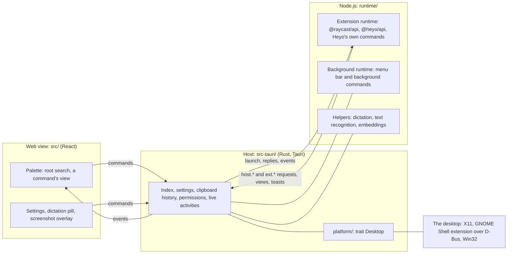
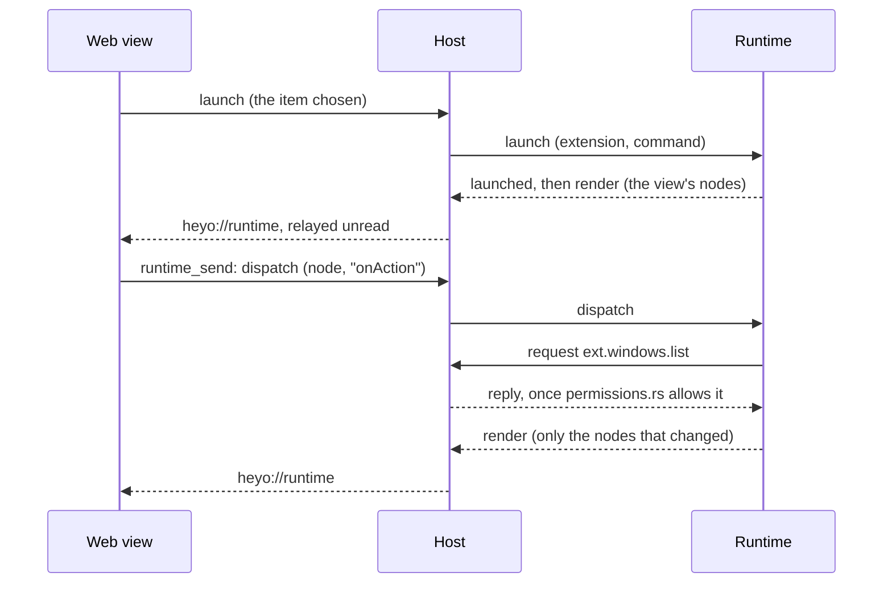

# How Heyo is built

For someone about to read or change the code. What Heyo does is in the
[README](../README.md); how to build, run and test it is in
[development.md](development.md).

## The three parts

Heyo is three programs that talk to each other, and a layer that talks to
the desktop.



- **The host** (`src-tauri/`, Rust, [Tauri](https://tauri.app) 2) is the
  process the user starts. It owns the windows, the index of what can be
  opened, the settings, the clipboard history, the permissions extensions
  have been given and everything that touches the desktop. It starts the
  other two parts and carries their messages.
- **The web view** (`src/`, React 19, in WebKitGTK on Linux and WebView2 on
  Windows) draws every window. All windows load the same page;
  `src/main.tsx` picks what to draw from the window's label: the palette
  (`main`), the settings, the dictation pill, the screenshot overlay, a
  pinned capture. It keeps nothing of its own: what it shows it asked the
  host for, or was sent by the runtime.
- **The runtime** (`runtime/`, Node.js 22 or newer) runs extensions: the
  builds the Raycast Store hands out, loaded as they are. It gives them
  `@raycast/api`, `@heyo/api` and React, renders their components with a
  React reconciler into a tree of plain objects, and sends that tree to the
  web view to be drawn. Heyo's own view commands (the Store, Clipboard
  History, emoji, quicklinks and snippets, the AI commands, the Timer) are
  written the same way and live in `runtime/src/builtins/`.

The runtime is started when a command first needs it, and there may be two
of it: the one whose command is in the palette, and a second for menu bar
and background commands (`runtime/src/background.ts`), so that those never
disturb the command on screen. Dictation, text recognition and the
embedding model are further Node.js programs of their own (their engines
are native packages installed on demand), started the same way
(`src-tauri/src/helper.rs`). The launcher itself works without Node.js.

## How the parts talk

### One declaration for every message

A message that crosses between two parts is declared once.

- What the host reads or writes is declared in Rust, in
  `src-tauri/src/wire.rs`: what the runtime asks of the host for itself
  (`HostRequest`), what an extension asks through `@heyo/api`
  (`ExtRequest`), what the host tells the runtime (`HostMessage`), what the
  web view may tell the runtime (`WebviewMessage`), and the names of the
  events the host emits to its windows. `cargo test` writes the TypeScript
  of all of it into `shared/bindings/` (with
  [ts-rs](https://github.com/Aleph-Alpha/ts-rs)); the files are committed,
  and CI fails when they are not what the host declares.
- What the host only passes along, between the runtime and the web view,
  is declared in `shared/wire.ts`, where both ends can see it: the view
  tree (`WireView`, `WireNode`), toasts, `RuntimeMessage`, and what the
  host answers each `ext.*` request with (`ExtReplies`).

### Web view and host: commands and events

What a window asks of the host is a command: a `#[tauri::command]`
function, registered in `lib.rs`. Each is said twice more, and `cargo test`
fails until both are there:

- which windows may call it (`commands/access.rs`). Every window loads the
  same page and the palette draws what extensions hand it, so a window is
  held to the commands its own view calls: a palette that was talked into
  something still cannot change the settings;
- what it takes and answers as a window sees it (`commands/bindings.rs`,
  which also says what every event carries). That table is written to
  `shared/bindings/commands.ts`.

The web view calls through that table: `call("copy_text", { text, paste })`
and `listen("settingsChanged", …)` from `src/host.ts` do not compile with
a name, an argument or a payload the host does not have
(`src/host.check.ts` holds that to its word). A call that fails is handled
where it matters and otherwise ends in `.catch(reported(…))`, which shows
it in the window's toast or error line. Tests of the web view play the
host with `fakeHost` (`src/host.fake.ts`), typed by the same table.

### Host and runtime: JSON lines

The runtime's process talks to the host in JSON, one message a line, over
its stdin and stdout. What it writes to stderr joins Heyo's log.
`src-tauri/src/runtime.rs` sorts what arrives (`route`):

| The runtime sends | Who answers |
|---|---|
| a request whose method begins `host.` (the clipboard, opening things, hiding the palette, the index, the keeping of the clipboard history) | the host, in `host.rs` |
| a request whose method begins `ext.` (windows, the screen, dictation, the file index, live activities, …: everything behind `@heyo/api`) | the host, in `ext.rs` and `ext/answer.rs`, after asking `permissions.rs` |
| anything else from the palette's runtime (`launched`, `render`, `toast`, a `ui.confirm` request, …) | the web view: the host relays it unread as the `heyo://runtime` event |
| anything else from the background runtime (`menu`, `background-done`) | `menubar.rs` |

In the other direction the host sends `launch` (start this command),
`background-run`, the replies to requests, `event` (something a command
subscribed to has happened), `oauth-callback`, `appearance` and
`dev-reload`; and it passes on what the web view says through the
`runtime_send` command: `dispatch` (call the function at this node and
prop, such as an `onAction`), `pop`, `close`, `reply`.

On the runtime's side, `transport.ts` is what carries the conversation
(the process's pipes, or a pair in memory with a test in the host's place)
and `protocol.ts` is the conversation itself: `request()` for `host.*` and
`ui.*`, `ask()` for `ext.*` (which says which extension is asking), and
`on()` for what the host sends.

A subscription is a request the host answers with a number; events with
that number follow until the command ends it, the command itself ends, or
the runtime's process is gone (`ext.rs`, `runtime/src/heyo/events.ts`).

### A command, from Enter to the screen



Function props cannot cross a process boundary: the runtime sends
`{ $fn: 1 }` in their place, and the web view calls them back by node id
and prop path (`runtime/src/renderer.ts`). After the first, a `render`
carries only the nodes that changed (`runtime/src/session.ts`). What is
typed into a field the extension controls belongs to the field at once and
the extension is told after, so that a slow extension cannot lose
keystrokes or break an input method's composition (`src/raycast/typing.ts`).

## The source tree

```
src-tauri/          the host (Rust)
  src/              see "The host" below
  icons/            the application's icons, made by scripts/app-icon.py
                    from the picture in source/
  tauri.conf.json   windows, what the web view may load, what a package holds
src/                the web view (React, TypeScript)
  raycast/          draws what extensions render: List, Grid, Detail, Form,
                    the action panel
  styles/           SCSS: scales, mixins, tokens, a partial per component
runtime/            what runs in Node.js (TypeScript), bundled by build.mjs
  src/              into runtime/dist/heyo-*.cjs
    api/            the @raycast/api implementation
    heyo/           the @heyo/api implementation
    builtins/       Heyo's own commands
    dev/            heyo build, dev, migrate, ext check
shared/             what more than one part reads
  bindings/         generated from the host's types by cargo test
  wire.ts           messages the host only passes along
  placeholders.ts   {query}, {clipboard}, {date}… for quicklinks and snippets
packages/api/       @heyo/api as extension authors install it: types, and a
                    stand-in for use outside Heyo
gnome-extension/    the GNOME Shell extension Heyo carries, for Wayland
packaging/          how packages are built (packaging/README.md)
scripts/            install.sh, the GUI sandbox, the Wayland container, the
                    Windows machine, the compatibility run, the icon and
                    shadow generators
docs/               the documents (docs/README.md lists them)
```

## The host

`lib.rs` is the start: it builds the Tauri application, registers the
commands, holds the shared state (the index, the settings, the runtimes)
and keeps the list of applications current. The rest, by what it is for:

**Opening things.**

- `root.rs` is the root search: applications, commands, quicklinks and
  snippets, ranked by fuzzy match (`search.rs`, with nucleo), how often
  and how recently each was used (`usage.rs`), aliases and favourites.
- `open.rs` is the one way an item is opened, by its id
  (`app:<desktop id>`, `cmd:<extension>:<command>`,
  `heyo:<native command>`, `quicklink:<id>`, `snippet:<id>`), whether it
  was chosen in the palette, bound to a hotkey or asked for with
  `heyo --open`. `cli.rs`
  reads the command line, including what a second `heyo` hands to the
  running one.
- `apps.rs` and `apps/` find the installed applications: freedesktop
  `.desktop` entries, or the Start menu's shortcuts and Store applications
  on Windows. `extensions.rs` finds the installed extensions and their
  commands, and declares Heyo's own.
- `palette.rs` is the palette's window and all that is done with it. The
  rest of the host says what it means (the palette is opened, is done
  with, makes way for a capture, is needed for a question) and never has
  the window in hand.

**Running extensions.**

- `helper.rs` is the one place that finds the Node.js scripts, starts
  them, frames their messages and notices them ending. It refuses a script
  whose first line does not name this version of Heyo. `runtime.rs` is the
  extension runtime as a helper, and the relay described above.
- `host.rs` answers the runtime's own requests. `ext.rs` answers what
  commands ask through `@heyo/api`, each on a thread of its own, since an
  answer may wait on a question to the user.
- `ext/answer.rs` decides what an `ext.*` request is answered with: who
  asks, whether they may, whether this session can, and then the thing
  itself. Everything it consults or changes is handed in as a `World`
  (Heyo's tables, and a port, `Running`, for what only the running
  application can do), and what is left to do once the answer is known
  comes back as `Effect`s. So a test answers requests with tables of its
  own and a fake desktop, and needs no application.
- `permissions.rs` is what an extension may ask for and who said so: the
  permissions its manifest lists, the ones the user granted (kept in
  `permissions.json` until taken back in the settings), and the decision
  for one request. It is consent and a record, not a sandbox: extensions
  run in one Node.js process and can read files themselves. `confirm.rs`
  is how the host puts a question of its own into the palette's dialog.
- `menubar.rs` turns menu bar commands into tray icons and runs commands
  that have an `interval`. `links.rs` registers Heyo for the `raycast://`
  links that OAuth sign-ins come back through.

**Doing things for the user.**

- `pasting.rs`: every paste goes through here, whether it comes from
  dictation, a snippet, an extension or the palette. Heyo types nothing
  itself: it puts the text on the clipboard and presses the application's
  paste shortcut. Text the user did not copy goes onto a clipboard on loan
  (`Loan`) and what was there comes back afterwards; several lines bound
  for a terminal are asked about first, or go in on one line.
- `clipboard.rs` and `clipboard/` are the clipboard history: what is
  recorded and what is not (`sources.rs`), where it is kept (one SQLite
  file with two full-text indexes, `store.rs`), how a query is read
  (`query.rs`: when, from where, what kind), and the optional search by
  meaning with a model on the computer (`meaning.rs`, `vectors.rs`,
  `fusion.rs`). `eval.rs` measures the search.
- `activities.rs` is the live activities (things in progress, shown in the
  palette's "In Progress" section and as notifications). The table
  (`Table`) is plain data with the time passed in; what a change calls for
  outside it comes back as `Effect`s, which a thin shell at the bottom of
  the file carries out. The limits, the ordering and the timers are all
  tested without a window.
- `screenshot.rs`, `ocr.rs` and `dictation.rs` are those features: the
  capture and the overlay's outcome, the text-recognition helper, the
  dictation helper with its progress window and its pasting.
- `expand.rs` expands a snippet's keyword as it is typed in another
  application. The keyboard is only listened to, never grabbed, and what
  is typed is neither stored nor logged; the module header says exactly
  when a keyword counts as typed.
- `library.rs` reads quicklinks and snippets; `files.rs` is the in-memory
  file search.

**Keeping the house.**

- `settings.rs`: see "Settings" below. `paths.rs` names every place Heyo
  keeps things, once (the XDG base directories; on Windows `lib.rs` points
  those at `%APPDATA%` and `%LOCALAPPDATA%` first).
- `diagnostics.rs` keeps the log, writes panics into it and assembles what
  "Copy Diagnostics" copies, with secrets and the home directory scrubbed.
- `renderer.rs` chooses how WebKitGTK draws (on the GPU, or on the CPU
  where NVIDIA's driver leaves no other way) before the web view exists.
- `updates.rs` is the updater, which is not compiled unless a build asks
  for it ([packaging/README.md](../packaging/README.md)).

## The platform layer

`src-tauri/src/platform/` is where Heyo meets the desktop it runs on.
Anything that touches the desktop goes through it.

Its modules of plain functions are what the rest of Heyo uses: `windows`
(listing, switching, layouts), `input` (the paste keystroke, the selected
text), `clipboard_watch`, `capture`, `overlay`, `keys` (hold to talk),
`typed` (what is typed elsewhere, for snippets), `hotkeys`, `focus`,
`system` (locking, the volume, the trash, audio devices, processes) and
`common` (notifications, keeping awake). They hold what is the same
everywhere and ask the session's adapter for the rest.

The seam is one trait, `desktop::Desktop`: everything Heyo asks of a
desktop. Each session has one adapter, chosen once:

| Adapter | Session | Through |
|---|---|---|
| `x11::X11` | X11 | EWMH for windows, XFixes for the clipboard, XInput for the keys it listens to, direct screen reads, `xdotool` for the paste keystroke |
| `gnome::Gnome` | GNOME on Wayland, when Heyo's Shell extension answers | D-Bus calls to the extension |
| `win::Windows` | Windows | the Win32 API |
| `desktop::Generic` | anything else | generic tools, where there are any: `wtype` or `ydotool`, a polled clipboard, `gnome-screenshot` |

What an adapter does not implement stays at the trait's default, which
says "not supported": nothing falls through to another desktop's tools by
accident. `platform::capabilities()` reports what the session can do, so
commands that cannot work are left out of the search and the settings say
why. Supporting another desktop is one more adapter; a capability new to
all of them is one more method, and the compiler finds nothing else to
change. Tests put `desktop::fake::Fake` in the adapter's place.

### GNOME on Wayland

On Wayland an application cannot see other windows, type into them, follow
the clipboard while unfocused, or read the screen; the Shell can. Heyo
carries a small Shell extension, `gnome-extension/heyo@heyo.app` (GNOME 45
to 50), that does those things for it over D-Bus and answers only the
process that owns Heyo's bus name. Settings → General offers to install
it, and to update it when a newer Heyo carries a newer one, after which
the user logs out and in again: GNOME only loads a new or updated
extension when a session starts, and an older one keeps serving until
then (`platform/gnome/extension.rs`).

With it, window switching and layouts, pasting, the selected text,
clipboard history and screenshots work as on X11, and the hold-to-talk
key works with the modifier keys. Snippets do not expand as they are
typed: that would put a listener for every key into the Shell, and has
deliberately not been done. Without the extension, or on another Wayland
desktop, the `Generic` adapter is what is left.

[wayland.md](wayland.md) has the details: what Heyo needs of a compositor,
how each version of GNOME differs, and what KDE and the wlroots
compositors could offer.

### Windows

`platform/win/` is the adapter for Windows, through the Win32 API: other
applications' windows, pasting, the selected text (UI Automation, else a
copy that is put back), the clipboard, the screen, a key held to talk, and
global hotkeys registered with the system and kept in `hotkeys.json`.
What it works out without asking Windows is in `win_rules.rs`, and what
the Start menu's files say is in `apps/shortcut.rs`: kept apart so that
they are compiled and tested wherever Heyo is built.

Part of this has run in a Windows machine and part has only been compiled;
the [README](../README.md#where-it-runs) says which, and
`scripts/windows-test/CHECKLIST.md` is the list of what is to be tried.

### Hotkeys

Hotkeys need nothing from a compositor but a way to run a command. Heyo is
single-instance: running `heyo` again hands its arguments to the one that
is running, so every hotkey is `heyo` (toggle the palette),
`heyo --clipboard` or `heyo --open <item id>`. On GNOME, Heyo writes them as
custom keyboard shortcuts with `gsettings` (`platform/hotkeys.rs`); on
Windows it registers them itself.

## The web view

- `App.tsx` hosts the root search or a running command.
- `RootSearch.tsx` is the root search as it is drawn, with the keys and
  clicks it takes. What a row is and does, it asks `rows.ts`: `rowsFor`
  puts the four kinds of row in order (what is in progress, the
  calculator's answer, what the search found, what else the query can be
  used with) and `describe` says what a row does, as groups of actions.
  Nothing in `rows.ts` draws or keeps anything, which is what makes it
  testable. `calculator.ts` is the arithmetic, the units, the currencies
  and the time zones.
- `raycast/` draws what extensions render. `CommandView.tsx` is a running
  command (search bar, body, footer, action panel); `ListView.tsx`,
  `Detail.tsx` and `FormView.tsx` are the bodies; `actions.tsx` is the
  action panel, the same one for an extension's actions and the root
  search's; `model.ts` reads the tree the runtime sends; `memory.ts`
  remembers what a view was showing when another was pushed over it.
- `Settings.tsx`, `Dictation.tsx` and `Screenshot.tsx` are the other
  windows.
- `selection.ts` and `pointer.ts` are what every list shares: how the
  selection moves, and when a mouse event is the pointer really moving.
  `SelectionIndicator.tsx` is the one element that slides between rows.
- `ime.ts`: while an input method is composing, Enter, Escape and Tab are
  its own. Every key handler that acts on those asks `composing(e)` first.

## The runtime

- `main.ts` is the process and its pipes; `runtime.ts` is the runtime as
  the host knows it: what extensions are handed when they load, and what
  each of the host's messages does. A test starts it with itself in the
  host's place (`testhost.ts`, `testing.ts`).
- `session.ts` runs one command at a time and sends its views;
  `renderer.ts` is the React reconciler behind that.
- `api/` is `@raycast/api`: the components (`components.ts`), navigation,
  the parts that are not interface (`system.ts`: clipboard, `open`,
  storage, …), OAuth, window management. What is there by name and does
  not do its work on Heyo is said once, in `shortfalls.ts`.
- `heyo/` is `@heyo/api`: everything of `@raycast/api` under the same
  names, and Heyo's own on top. Every function Heyo adds is declared once,
  in `members.ts`: the module it is in, its name and the request it asks
  of the host. A function that is nothing but its request is made from the
  declaration; the permission it needs and what it answers with follow
  from the request (`shared/bindings/needs.ts`, `ExtReplies`); and
  `types.check.ts` holds the types authors see (`packages/api/index.d.ts`)
  to what the runtime provides.
- `builtins/` is Heyo's own commands, written against `@heyo/api` as an
  extension would be.
- `dev/` is the developer tools, bundled separately as `heyo-dev.cjs` and
  started by `heyo build`, `dev`, `migrate` and `ext check`
  ([developing-extensions.md](developing-extensions.md)).
- `dictation.ts`, `ocr.ts` and `embed.ts` are the helpers, each a program
  of its own. `install.ts` fetches their engines and models: exact
  revisions, checked against hashes written in the source.
- `compat.ts` helps extensions written with only macOS in mind, where
  something can be done, and says so clearly where not.

## Settings

A setting is declared once, as a field of `Settings` in
`src-tauri/src/settings.rs`. The windows' TypeScript type is generated
from it into `shared/bindings/`. A window changes settings by sending only
the fields that change (`change_settings`); the host merges them into the
rest (`Settings::changed`), saves, does what the change calls for
(`consequences`) and tells every window. So adding a setting is adding the
field, its default and its control. "Launch at login" is not stored: it is
whether the autostart entry exists.

## Styles and themes

The interface has a light and a dark scheme, following the system unless
Settings → General → Theme says otherwise. Both are one two-tone design:
neutrals for everything, one accent for what is active.

The stylesheet is SCSS, in `src/styles/`:

- `abstracts/_scales.scss` holds the scales as Sass maps, the single source
  for every colour (as a light and dark pair), the 4 px spacing grid, the
  type scale (each size with its line height and letter spacing), radii,
  control heights, shadows, durations and easings.
- `abstracts/_mixins.scss` is what components are assembled from: `text`,
  `truncate`, `fade-end`, `scroll-fade`, `interactive` (resting, hovered,
  pressed, disabled), `field`, `select`, `card`, `floating`, `focus-ring`,
  `enter`.
- `base/_tokens.scss` turns the scales into custom properties. Colours are
  emitted as CSS `light-dark()` and follow `color-scheme`, so there is no
  second stylesheet and no script deciding colours; `src/theme.ts` only
  sets `data-theme` when the setting overrides the system.
  `base/_motion.scss` has the keyframes, `base/_reset.scss` the page.
- `components/` has a partial per part of the interface. They use the
  tokens and mixins and no colours or sizes of their own.

Details that go with it: the palette's window is larger than its panel by
a transparent margin for the panel's shadow (a click there hides it), and
the shadow is a picture laid round the panel rather than a blurred
`box-shadow`, which is recomputed at every redraw where the web view draws
on the CPU (`scripts/window-shadow.py` draws the pictures); the icon at
the start of a row is an application's own, a symbol on a tile, or an
initial (`ItemIcon.tsx`); lists that are loading show skeleton rows; views,
the action panel and dialogs arrive with a short animation. What floats
over the screen (the screenshot tools, the dictation pill) stays dark.
Colours that extensions name (`Color.Blue`, `{ light, dark }`) map to
tokens too. More contrast and less motion are given where the system asks
for them.

## Where Heyo keeps things

All of it is named in `paths.rs`, and the runtime is told the same roots
when it starts.

| What | Where (Linux) |
|---|---|
| Settings, extension preferences, granted permissions | `~/.config/heyo/` |
| Extensions, clipboard history, quicklinks, snippets, usage, what extensions store, the engines installed on demand | `~/.local/share/heyo/` |
| The log, captures, an extension's `Cache` | `~/.cache/heyo/` |

On Windows the first two are `%APPDATA%\heyo` and the last is
`%LOCALAPPDATA%\heyo`.

## Where tests stand in

The parts are made to be tested without the others, and each seam has its
stand-in:

| Seam | In the application | In a test |
|---|---|---|
| the desktop (`platform::desktop::Desktop`) | `X11`, `Gnome`, `Windows`, `Generic` | `desktop::fake::Fake` |
| the host, as a window calls it (`Bridge` in `src/host.ts`) | Tauri | `fakeHost` (`src/host.fake.ts`) |
| what carries the runtime's conversation (`Transport` in `runtime/src/transport.ts`) | stdin and stdout | a pair in memory, with `testhost.ts` as the host |
| the running application, as `ext/answer.rs` sees it (`Running`) | the Tauri side of `ext.rs` | tables and a port made by the test |

What only shows in a window is tried in the GUI sandbox
([development.md](development.md#the-gui-sandbox)).
